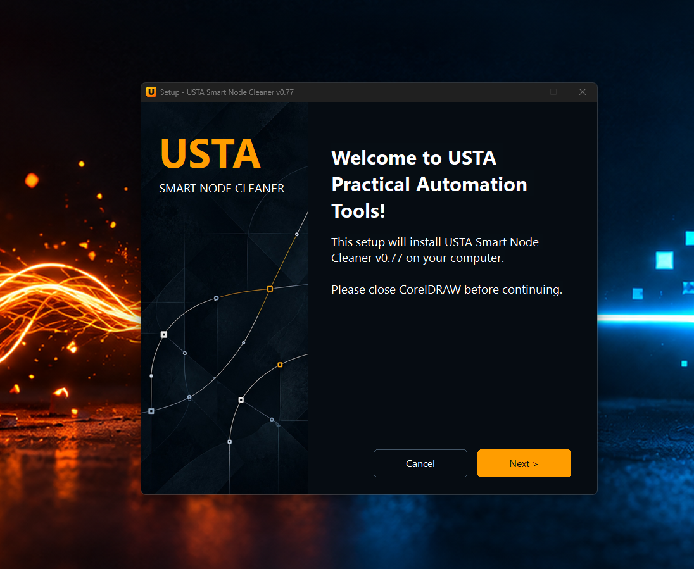
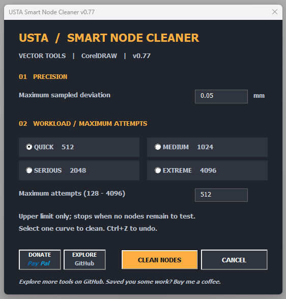
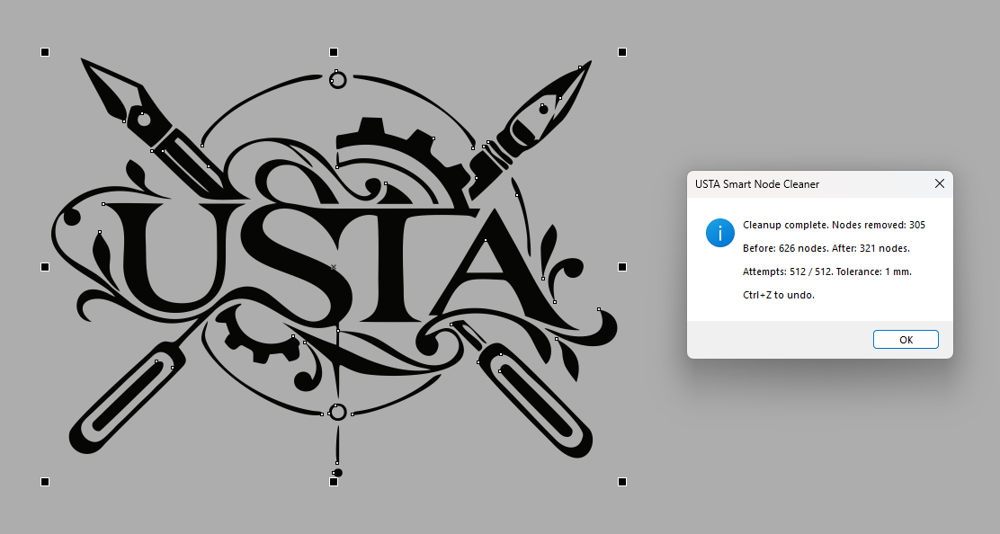

# USTA Smart Node Cleaner v0.77 — CorelDRAW Bézier Node Reduction

**Too many nodes after tracing? Clean up vector curves with a tolerance you control.** USTA Smart Node Cleaner is a free, open-source CorelDRAW VBA tool for reducing unnecessary Bézier nodes in logos, lettering, traced artwork and production-ready vector paths.

**[Download USTA Smart Node Cleaner v0.77 for Windows](https://github.com/corniykot/usta-practical-automation-tools/releases/tag/smart-node-cleaner-v0.77)** · [Installer & VBA source](installer-v0.77/) · [Report an issue](https://github.com/corniykot/usta-practical-automation-tools/issues)

## See it in action

**Real-world example:** 626 → 600 nodes (26 removed) at a 0.05 mm tolerance. Results vary with curve geometry and settings.

## What makes it useful?

CorelDRAW's built-in **Reduce Nodes** is handy for quick smoothing. USTA adds a different kind of control: **you set the permitted deviation in millimeters**. Each proposed node removal is checked against the original curve using a two-way sampled geometric comparison.

- **Trace cleanup:** simplify dense PowerTRACE and bitmap-to-vector results.
- **Production vectors:** prepare curves for laser cutting, engraving, vinyl cutting, CNC and plotters.
- **SVG design:** tidy complex logos, icons and illustrations before SVG export.
- **Reversible workflow:** inspect the result and use **Ctrl+Z** when needed.

The tool processes **one selected Curve object** at a time. It simplifies existing curves rather than repairing open paths or optimizing cutting order.

## Install in minutes

1. [Download the v0.77 installer](https://github.com/corniykot/usta-practical-automation-tools/releases/tag/smart-node-cleaner-v0.77) and close CorelDRAW.
2. Run `USTA-Smart-Node-Cleaner-v0.77-Setup.exe` and select the detected CorelDRAW profile.
3. Reopen CorelDRAW, select a curve and launch USTA from the **Standard toolbar**.
4. Set your tolerance and workload, run the cleaner and review the node counts.

**Requirements:** Windows 64-bit and CorelDRAW with VBA. The installer discovers CorelDRAW X7–2022 (versions 17–24). Compatibility depends on the installed version and workspace; a customized/locked toolbar case remains under investigation.

## Open source, testing & signing

USTA has been developed and tested in **real CorelDRAW environments**. The [GitHub Actions build](https://github.com/corniykot/usta-practical-automation-tools/actions/workflows/build-usta-v077.yml) separately checks installation logic and builds the Windows EXE; those automated checks are not a substitute for hands-on CorelDRAW testing.

The [v0.77 release](https://github.com/corniykot/usta-practical-automation-tools/releases/tag/smart-node-cleaner-v0.77) includes an installer and SHA-256 checksum. **This first release is unsigned** while the project prepares an application to the SignPath Foundation open-source signing program.

**Code signing policy:** Release candidates are reviewed by the maintainer, built using the published GitHub Actions workflow and checked before publication. Signing access, when enabled, will be restricted to authorized maintainers using two-factor authentication, with approval required for signing requests. The workflow packages the [published prebuilt GMS](installer-v0.77/UstaSmartNodeCleaner.gms); [readable VBA source](installer-v0.77/vba/) is provided for inspection, but CI does not compile the GMS from those files. No claim of a signed binary is made for v0.77.

The tool is designed to work locally within CorelDRAW, without a USTA account or cloud service.

[MIT license](../../LICENSE) · [Previous v0.73 version](USTA%20Smart%20Node%20Cleaner%20v0.73/) · [Historical versions](Historical%20Versions/) · [usta.scripts@gmail.com](mailto:usta.scripts@gmail.com)

*Less time negotiating with Bézier.*
