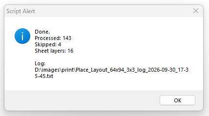

# Photoshop 64×94 mm Otomatik A4 Yerleşim — 3×3

Bir klasördeki görselleri tek tek Photoshop'a taşıyıp ölçülendirmek ve cetvelle hizalamak yerine, **64 × 94 mm görselleri A4 üzerine otomatik olarak 3 × 3 yerleştirin**.

`Place_Layout_64x94_3x3_safe_v2.jsx`, görsellerin yönünü kontrol eder, her birini tam **64 × 94 mm** boyutuna getirir ve A4 dikey sayfaya **9 adet** yerleştirir. Her 9'lu grup tek bir Photoshop katmanında birleştirilir; son grup eksik olsa bile ayrıca birleştirilir.

Hatalı veya açılamayan bir dosya tüm işlemi durdurmaz. Dosya atlanır ve bir sonraki geçerli görsel boş kalan yeri kullanır.

## Yerleşim

- A4: **210 × 297 mm**, dikey
- Görsel: **64 × 94 mm**
- Düzen: **3 × 3**
- Görsel sayısı: **9 / sayfa**
- Aralıklar: **2 mm**
- Kenar payları: **sağ/sol 7 mm**, **üst/alt 5,5 mm**

Yatay kaynak görseller otomatik olarak dikey yöne çevrilir ve hedef ölçüye getirilir.

## Nasıl kullanılır?

1. Photoshop'ta **210 × 297 mm A4 dikey** bir belge açın.
2. **File → Scripts → Browse…** yolunu açın.
3. `Place_Layout_64x94_3x3_safe_v2.jsx` dosyasını seçin.
4. Görsellerin bulunduğu klasörü seçin.
5. Script dosyaları sırayla yerleştirir ve her 9 başarılı görseli tek bir sayfa katmanında birleştirir.

Desteklenen formatlar: JPG, JPEG, PNG, TIFF, PSD, BMP.

Scripti Photoshop'un `Presets/Scripts` klasörüne kopyalayıp Photoshop'u yeniden başlatırsanız doğrudan **File → Scripts** menüsünden de çalıştırabilirsiniz.

## Test

Safe v2, hatalı dosyalar içeren bir batch ile Photoshop CS6'da test edilmiştir:

- **143 işlendi**
- **4 atlandı**
- **16 sayfa katmanı oluşturuldu**
- hata kayıt dosyası başarıyla oluşturuldu

## İletişim

64×94 görselleri tek tek cetvelle hizalamak kişisel gelişim programınızın parçası değilse bize yazın: [**usta.scripts@gmail.com**](mailto:usta.scripts@gmail.com)
