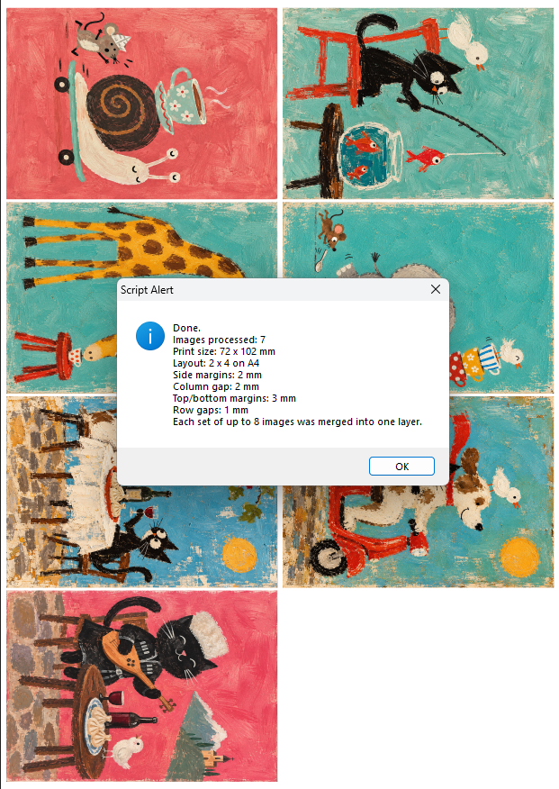

# Photoshop 72×102 mm A4 Baskı Yerleşimi — 8 Görsel

`Place_Layout_72x102_safe_v2.jsx`, bir klasördeki görselleri Photoshop'a toplu olarak yerleştirir, yönlerini düzeltir, tam **72 × 102 mm** boyutuna getirir ve bir A4 sayfaya **8 görsel** yerleştirir.

Her 8'li grup tek bir Photoshop katmanında birleştirilir. Son grup 8'den az görsel içeriyorsa o da ayrı bir sayfa katmanı olarak birleştirilir.

## 72×102 mm neden?

Standart A7 ölçüsü **74 × 105 mm**'dir. Bu üretim düzeni standart A7 kullanmaz.

Buradaki **72 × 102 mm**, **70 × 100 mm bitmiş ürün için her kenarda 1 mm taşma payı (bleed)** bırakacak şekilde hazırlanmıştır.

Bu nedenle özellikle küçük baskılar, mini sanat işleri, magnet, sublimasyon, transfer ve benzeri üretim işlerinde kullanışlıdır.

## Ne yapar?

- JPG, JPEG, PNG, TIFF, PSD ve BMP dosyalarını işler
- dosyaları adlarına göre sıraya koyar
- görselleri Smart Object olarak yerleştirir
- yatay kaynakları otomatik olarak dikey yöne çevirir
- her görseli tam **72 × 102 mm** boyutuna getirir
- baskı yerleşimi için 90° döndürür
- A4 üzerinde **2 × 4 düzeninde 8 görsel** yerleştirir
- her 8'li grubu tek bir `Sheet_XX_8pcs` katmanında birleştirir
- bozuk veya açılamayan bir dosyada durmaz; dosyayı atlayıp devam eder
- hatalı dosya boş bir yerleşim konumu bırakmaz
- yalnızca gerçekten hata olursa TXT kayıt dosyası oluşturur

## Nasıl kullanılır?

1. Photoshop'ta **210 × 297 mm A4 dikey** bir belge açın.
2. **File → Scripts → Browse…** yoluna gidin.
3. `Place_Layout_72x102_safe_v2.jsx` dosyasını seçin.
4. Görsellerin bulunduğu klasörü seçin.
5. Script dosyaları işler, 8'li sayfalara böler ve her sayfayı tek katman halinde birleştirir.

Desteklenen formatlar: JPG, JPEG, PNG, TIFF, PSD, BMP.

İsterseniz JSX dosyasını Photoshop'un `Presets/Scripts` klasörüne kopyalayıp Photoshop'u yeniden başlatabilirsiniz.

## Güvenli batch işleme

Bir kaynak dosya açılamaz veya işlenemezse bütün batch durmaz. Problemli dosya atlanır ve sıradaki geçerli görsel aynı yerleşim konumunu kullanır.

Hatasız çalışmada TXT log oluşturulmaz. Hata olursa kayıt dosyası önce scriptin bulunduğu klasörde, bu mümkün değilse kaynak görsel klasöründe oluşturulur.

Bu safe v2 sürümü Photoshop CS6'da test edilmiştir.

## Not

Genişlik ve yükseklik tam **72 × 102 mm** değerine zorlanır. Kaynak görsel bu orana uygun değilse oranı değişebilir.

Script görseli akıllı biçimde kırpmaz veya yeniden kompoze etmez; kaynak dosyanın baskıya uygun hazırlanmış olması gerekir.

## İletişim

Sekiz görseli milim milim elle dizmek size hâlâ “işin doğası” diye satılıyorsa, o doğaya biraz müdahale edelim. Photoshop'ta başka hangi tekrar eden işi otomatikleştirelim, yazın: [**usta.scripts@gmail.com**](mailto:usta.scripts@gmail.com)
